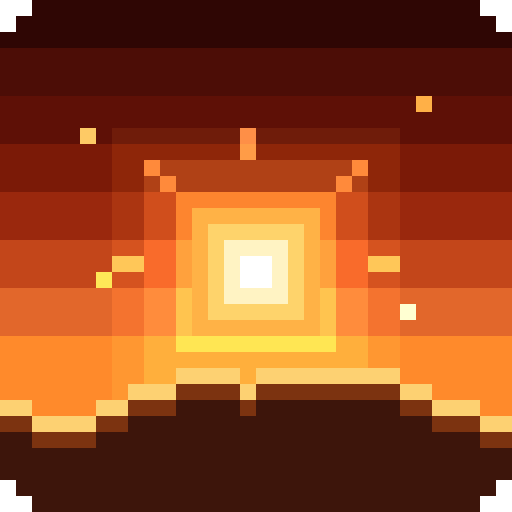

# Sol Client



A client-side Fabric mod built around the sky (mod id `cosmeticsmod`).
- **Themes:** every Atmosphere theme lights the world with its own light.
- **Menus:** the Sol quick menu and full menu.
- **Wardrobe:** player cosmetics, drawn as a normal part of the player model.
- **Client modules.**

It is built to coexist with any client mod: Sodium, Iris and shaderpacks, Voxy, Distant Horizons, ImmediatelyFast,
Entity Culling, EMF/ETF, 3D Skin Layers, Figura and Essential. See [COMPAT.md](COMPAT.md).

One source tree builds a jar for every Minecraft release from **1.21 to 26.3**:

| Jar (`build/libs/`) | Minecraft | Java |
|---|---|---|
| `solclient-<v>+mc1.21.1.jar` | 1.21, 1.21.1 | 21 |
| `solclient-<v>+mc1.21.3.jar` | 1.21.2, 1.21.3 | 21 |
| `solclient-<v>+mc1.21.4.jar` | 1.21.4 | 21 |
| `solclient-<v>+mc1.21.5.jar` | 1.21.5 | 21 |
| `solclient-<v>+mc1.21.8.jar` | 1.21.6, 1.21.7, 1.21.8 | 21 |
| `solclient-<v>+mc1.21.10.jar` | 1.21.9, 1.21.10 | 21 |
| `solclient-<v>+mc1.21.11.jar` | 1.21.11 | 21 |
| `solclient-<v>+mc26.1.2.jar` | 26.1, 26.1.1, 26.1.2 | 25 |
| `solclient-<v>+mc26.2.jar` | 26.2 | 25 |
| `solclient-<v>+mc26.3.jar` | 26.3 | 25 |

The only required dependency is Fabric API.

## Using it

### Atmosphere

Atmosphere replaces the sky with a theme, chosen in the menu's World section, the quick menu's presets or Ctrl+K.
- **Themes:** Empty (the vanilla sky), Sakura Dusk, Frost Morning, Ember Solstice, Aurora, Firefly Meadow, Monsoon,
  Maple Afternoon, Eclipse, Deep Field, Silver Night and Grace.
- **Nebulae at night:** Sakura Dusk, Frost Morning, Silver Night and Maple Afternoon show huge painted nebulae among
  the stars at night, each in the theme's own colours.
- **Each theme's light:** it lights the world the way Ember's low sun lights the sand. Its colour falls on the
  faces turned toward it and the theme's shadow colour on the faces turned away. It adds rims, bloom, light shafts,
  scattering in the fog, lit particles and the theme's colour grade.
- **The lights:**
  - Grace: the rune.
  - Eclipse: the burning ring.
  - Aurora: the curtains' moving green and violet light.
  - Deep Field: cold silver.
  - Silver Night: the moon, with a glitter path on water.
  - Monsoon: each lightning flash.
  - The others: their sun, and the moon at night.
- **Night themes keep their night** at any time of day. This is visual only: the game's time is not changed.
- **Atmosphere intensity** (100% by default) tones the look down.
- **Quality:** Low, Medium, High or Auto.
- **Theme packs:** resource packs can add themes; see [docs/ATMOSPHERE_FORMAT.md](docs/ATMOSPHERE_FORMAT.md).

### The quick menu (Right Shift)

A sundial in pixels: the wheel is pixel art at two design pixels a pixel, and the world behind it is drawn in the
same pixels. The sun circles the dial and lights the screen; below the horizon the moon takes its place.
- **Top bar:** the Quick menu tab, Modules, Presets, Wardrobe and Emotes, search, you, and the red close.
- **Sections:** point at one (HUD, Modules, World, Music, Settings, Mods) to open the full menu there. Every label
  fits inside its own segment at any window size (a test checks each ring at four screen sizes).
- **Your own ring:** pointing at yourself starts the eclipse and opens your ring: Presets, Emotes and Wardrobe.
- **Colours:** along the bottom of the presets wheel: Default (the theme's own), Music (the playing song's), a row of
  colours and a picker for any colour (the square, the hue bar, a hex code). The colour you pick is the theme's
  colour everywhere at once, live while you drag.
- **The tray:** your pinned modules, presets with live sky thumbnails, profiles, and emotes.
- **Search:** type anywhere.

### The full menu

A pixel window with a title bar: Sol's icon, back, the tabs, you and the red close. Sol's horizon runs under the
bar, with the sun sitting on it under the tab you're on.
- **Tabs:** Modules, HUD, World, Presets, Wardrobe, Emotes, Music, Mods and Settings; Sol's icon goes back to the
  quick menu.
- **Ctrl+K:** finds and runs any module, setting, preset, section, profile or action.
- **Profiles:** your slab in the title bar switches whole setups.
- **Modules:** Dawn's mod menu in Sol's pixels. Cards four to a row, each with its icon, ENABLED or DISABLED, a pin
  star and a gear for its settings; filter tabs and a search.
- **Presets:** every theme as a card with its sky in pixels; the preview pane shows the one you point at under Sol's
  logo. Apply preset and Random.
- **Emotes:** your wheel's page as eight slots, the page controls in the middle, and you on the right doing it.
- **Main folder:** Settings › Main folder.

### Wardrobe

**Where it opens:**
- the "Open Cosmetics" key (unbound by default, so it can't clash with another mod);
- `/cosmetics`;
- the menu's Wardrobe section;
- Settings › Cosmetics.

**Layout:** the views down the left (with counts and the source they come from), glass tiles in the middle, and
you on the right in a 3D preview (drag to turn and tilt; the Elytra chip puts one on you).

**Tiles:**
- Each tile has its own picture of the cosmetic alone, turned three quarters towards you.
- The one you point at turns, and shows on you in the preview.
- Click a tile to put it on or take it off.
- Putting one on takes off the one of its kind you wore (new wings replace your wings, not your backpack), unless
  "Wear several of one kind" is on.

**A cosmetic's page** (the gear on its tile). A cosmetic can leave some of these out:
- **Tint colour** or **rainbow**, with its speed.
- **Colouring:** how a picked colour or rainbow goes in.
  - Automatic: white cosmetics colour all over, coloured ones change colour.
  - Whole cosmetic.
  - Coloured parts.
  - Classic tint.
- **Follow theme colour:** Default (as "Theme colour on every cosmetic" says), Off (its own colour), the theme's
  accent, or its glow.
- **Saturation, hue and brightness.**
- **Its colours:** change one of its own colours and its shades; the others stay.
- **Size, Turn around, Upside down,** and move it sideways, up and forward.
- **Glow, animation** and its speed, and **style**.
- **Cloth cloak** (flat capes).
- **Show on elytra** (capes), and **Preview with an elytra**.
- **Particles:** on or off, amount and size.
- **Where a pet sits.**
- **Reset.**

**Outfits:**
- Save what you wear, with each cosmetic's settings.
- Point at an outfit to see it on you; click it to wear it.
- Its page renames it, updates it to what you wear now, or deletes it.

**Emotes:** play an emote, and put it on the emote wheel or the elytra wheel.

**Skins:**
- The skins saved in the Threadrinth/Modrinth app, when the main folder is its app folder. The launcher's database
  is only read, never written.
- Wear one: it is uploaded to your Minecraft account and shown on you at once.
- Your Mojang capes: click one to wear it, or No cape.

**Settings:**
- Display, Performance, Compatibility and Maintenance, with a search.
- **Keys:** the same key binds as in Controls (change either, both change).
- Per-slot visibility and per-slot priority, Iris and Figura handling, and Reload cosmetics.
- Other players' cosmetics by UUID, on your screen only.

**Notices at the top:**
- cosmetics in a resource pack that couldn't load (a broken file, or a model over `maxMeshTriangles`), with how many
  and why;
- a pack made by an older importer;
- your cosmetics being hidden.

Players' names move up above their hats, halos and other head cosmetics, so they never overlap.

Changes apply immediately and are saved when the Wardrobe closes. Reset settings restores the defaults but keeps
what you wear, your outfits and how each cosmetic looks; each cosmetic's page has its own reset.

### HUD tab

The menu's HUD section lists every element of the HUD: yours (Stats, Coordinates, Music, Lyrics, ...) and the game's
own parts (hotbar, hearts, hunger, boss bars, scoreboard, ...), each with its switch. Beside the list is a live
picture of the layout with the picked element lit (click a box to pick it), and that element's settings:
- **Your elements:** their look, size, text (shadow, font, colour) and background, which can go fully off (the text
  then gets a shadow in Sol's look).
- **The game's parts:** Sol UI's settings for them. The hotbar's selected slot lifts, grows in place or is only
  ringed; slot numbers, its light sweep and its glass (down to none) are switches; the hotbar and the bars over it can
  be sized; the hearts' and experience bar's glow can go.

### HUD editor

Open it from the menu's HUD section (Edit layout) or Ctrl+K. It works over the game as it is.
- **Moving:** drag the HUD modules and the game's own HUD parts (hotbar, health, armor, hunger, air, held item name,
  action bar, effects, boss bar, scoreboard).
- **Snapping:**
  - Boxes snap to the screen's edges and middle.
  - They line up with the other boxes and sit next to them with a small gap.
  - A line in the accent shows what they snapped to.
  - Hold Shift to move one freely.
- **Nudging:** the arrow keys move the box you last clicked by one pixel (ten with Shift).
- **Resizing:** scroll over a module.
- **Right-click:** a module opens its settings; a game part goes back where it was.
- **Modules** in the island switches HUD modules on and off.

### Quick wheel

Hold its key (unbound by default): your pinned modules sit in a ring round the crosshair. Let go on one to switch it
on or off.

### Modules

The module grid has 31 modules. Sol UI and Cosmetics start on; the starting profiles turn Atmosphere on as well;
the rest start off. Of the modules, only freelook (Left Alt) and fullbright (G) have keys until you bind more.
Pinned by default: Crosshair, Glint, Atmosphere and Camera.

A profile keeps every module's settings, the HUD layout, the pins, the theme, what you wear (cosmetics, outfit), your
skin and your cape. Switching profiles puts all of it back: the skin is sent to Mojang and the cape worn on your
account, only when they differ from what Sol last sent.

**The theme's colour everywhere.** Every colour setting can follow the theme's colour, and for every colour the
client draws, that's the default: the menus and HUD, the crosshair, the block outline, glint, the hit colour,
hitboxes, the hand glow, text HUDs, the movement status. Pick a colour under the presets wheel and all of them change
with it, at once. Colours there to stand out keep their own by default and can follow the theme too: the
crosshair's outline (black) and its colour on a target (red), keystroke text (white), Crystal PvP's low-health warning
(red). Crosshair, Block outline and Glint are on by default. Settings saved before this that were still at the old
default (a white crosshair, a cyan glint, a gold hand glow) follow the theme now; colours you picked stay.
Cosmetics keep their own colours unless you ask: "Theme colour on every cosmetic" (in the Cosmetics settings, off by
default) gives all of them the accent or the glow, and each cosmetic's page can follow it, stay its own or follow
the theme by itself.

| Module | What it does |
|---|---|
| Atmosphere | The theme's sky, sun, stars and planets, fog, light and particles. Advanced: each sun layer, theme fog and underwater view, clouds, more ambience (leaf bits, rain splashes, fireflies, sparks), stars, planets, time and weather locks. |
| Camera | Freelook (Left Alt) and freecam (singleplayer, or as an operator). |
| PvP Tweaks | Hurt cam strength, low fire, hit colour. |
| PvP Effects | Hit sounds, and a kill effect (lightning, a burst or a sound) only you see. |
| Hitboxes | Hitboxes always on, in your colour and line width, for players only if you like. |
| Held Items | A lower shield and a smaller totem pop. |
| Punchy | On by default (the Punchy mod itself stays optional). Switches the [Punchy](https://modrinth.com/mod/punchy-fpa) mod's first-person animations on and off when it's installed (off with the module), and gives Punchy Sol's tuning once: smaller hands nearer the middle. Sol arms (without Punchy by default, or always, or off): your arms and what they hold smaller and closer to the middle (hand size and centring sliders), the fallback when Punchy isn't installed; set to always with Punchy, the sliders move its hands on from its tuning. PvP mode (off): tones all of Punchy's animations down. Dark arms (off): your arms as flat black silhouettes. A glow round your hands and held item, in the theme's colours (or the item's, a rainbow or yours; gold by default when you pick your own): golden light round them (gold by default; its rise, bright core and deep edge are settings, the core and edge shades of whatever colour you pick, and no outline unless you turn it on), or a thin bright outline on its own, or a softer glow all round, with the hands themselves flat, and a motion trail: as your hands (or your knife) move, the light stays along the path they took, fading (not on 1.21.2 to 1.21.5). Rising lines of light through the softer glow are an option. The arms and glow work without Punchy too. Knives: wear a knife (a melee cosmetic from gunpacks you drop into `client/melee`, see [docs/COSMETIC_FORMAT.md](docs/COSMETIC_FORMAT.md#knives)) and the sword in your hand is that knife in first person, with your own arms: it draws, slashes (light attacks in turn, the heavy one on a critical hit), inspects on V (with Punchy installed, on Punchy's own inspect key, which then never plays Punchy's sword inspect while a knife is out) and shakes the view a little as in its own game, at its own pace (or fitted to Minecraft's sword). Settings: timing, heavy hit on crits, camera shake, sway, knife sounds, show hands the pack hides, knife in third person (off: third person shows the sword), use on swords or swords and axes; each knife's colour (tint, rainbow, colouring, saturation, hue, brightness, its own colours), model set and hand size on its Wardrobe page. While a knife is out, the shield or totem in your other hand stays hidden (the knife draws that hand). Sol makes a Ruby finish of the CS2 Skeleton Knife from your pack, and a model of your own can play another pack's animations. With Punchy installed, the knife is drawn alone while it shows (no Punchy hands under it), its hands at the size of Punchy's tuned ones, in the corner where Punchy's hand is. No knife pack is part of the mod. |
| Nametags | Health above heads; your own tag, size, backing and text shadow. |
| Screen | Switch off the pumpkin mask, powder snow frost, vignette, portal swirl, nausea, the underwater overlay and the darkening behind inventories; motion blur (not on 1.21.2 to 1.21.5). |
| Particles | A multiplier for hit particles, sharpness sparks on every hit, and fewer block, explosion and weather particles. |
| Glint | The enchantment shimmer in one colour, two, a rainbow or the theme's; in inventories the shimmer, an outline round the item's shape, or both. |
| Fullbright | Brightness (G), with night vision so it works with shaders. |
| Crosshair | Style, arm length, gap, thickness, dot, colour, opacity and outline, sharp at any GUI scale. |
| Block outline | The outline round the block you look at, in your colour and opacity. |
| Movement | Toggle sprint and sneak. |
| Sol UI | The game's HUD in the theme (hotbar, hearts, hunger with AppleSkin's data when it's installed, armour, XP, air, mount), plus tweaks: the hotbar (selected slot lifts, grows or is ringed; numbers, light sweep, glass), the size of the hotbar and bars, the hearts' and experience glow, the tab list (ping in ms, heads, players online, size), the scoreboard (shown, red numbers, size), boss bars and titles (shown, size). |
| Keystrokes, Stats, Coordinates, Armour & Items, Potion Effects, Music, Lyrics | HUD modules, each with its size, text and background (or none). Stats has FPS, CPS, ping, clock, memory, reach, combo, speed, server, resource pack, day, play time and a stopwatch, with or without its dots and labels; Coordinates a direction bar; Armour & Items an item counter, cooldowns, totem pops and durability warnings; Music what's playing as a card, a big cover, a slim pill or the cover alone, with live lyrics under it; Lyrics the line being sung on its own, anywhere. |
| Sol Chat | Timestamps (click to copy a message), stacked repeats, up to 5,000 messages kept, emoji shortcodes and an emoji picker. |
| World Overlays | Chunk borders, where mobs can spawn, beacon range, slime chunks (from the world's seed in singleplayer, `/seed` for operators, or a seed you type) and structure outlines in singleplayer. |
| Inventory | Durability as numbers on items. |
| Performance | Video presets: Low-end, Balanced and High. |
| Screenshots | Each screenshot copied to the clipboard. |
| Social | Discord status, and streamer mode (hides your name, skin, the server's address and private messages). |
| Servers | Auto reconnect, and the server list upgrade: pings in ms, players online, and folders (name a server `Folder/Name`). |
| Cosmetics | Capes, wings, hats and the rest, set up in the Wardrobe. |

### Main folder

- **Default:** the client uses the game's own `.minecraft` folder (`%APPDATA%\.minecraft` on Windows). It creates
  `client/` there, with its settings (`modules.json`) and profiles.
- **Another folder:** choose one in Settings › Main folder or in Wardrobe › Skins.
- **Threadrinth:** its app folder (or the Modrinth App's) has the same layout plus the launcher's database
  (`app.db`). With it chosen, the Skins view shows the skins saved in Threadrinth. When the client finds Threadrinth
  on the computer, it offers "Use Threadrinth".
- **Sharing:** every instance using the same main folder shares the client's settings. Switching to a folder that
  already has them takes them over.

The client's typeface is Geist (SIL Open Font License, `assets/cosmeticsmod/font/geist-ofl.txt`, Geist Mono included).

The night sky's stars come from the HYG Database v4.1 by David Nash (CC BY-SA 4.0), and its constellation lines and
names from d3-celestial by Olaf Frohn (BSD 3-clause); see `assets/cosmeticsmod/sky/CREDITS.txt`.

### Cosmetics

- **Bundled**:
  - `cosmeticsmod:top_hat`
  - `cosmeticsmod:halo` (glowing, slowly spins and bobs)
  - `cosmeticsmod:explorer_backpack`
  - `cosmeticsmod:feather_wings` (flapping)
  - `cosmeticsmod:glider_wings` (flap faster when moving or flying, fold when sneaking)
  - `cosmeticsmod:crown` (glowing, shimmering gems; made and animated in Blockbench as a Bedrock model)
  - `cosmeticsmod:orbit_ring` (a smooth-shaded gold ring from an OBJ mesh, circling the head)
  - `cosmeticsmod:starlight_cape` (with a glowing emblem)
  - `cosmeticsmod:ember_cape` (an animated texture)
  - `cosmeticsmod:wind_pennant` (a skeletal MD5 flag with two styles, "wave" and "calm")
  - `cosmeticsmod:knight_shield` (a shield cosmetic: shown instead of the vanilla shield while you hold one)
  - `cosmeticsmod:ember_aura`, `cosmeticsmod:frost_aura`, `cosmeticsmod:heart_aura` (particle auras); the starlight cape
    also leaves a sparkle trail while you move
  - `cosmeticsmod:pocket_slime` (a pet: sits on your left shoulder and bobs)
  - `cosmeticsmod:wristband` (on the left arm) and `cosmeticsmod:cloud_boots` (on both feet, puffing little clouds as
    you walk)
- **Add more** from any resource pack at `assets/<ns>/cosmetics/*.json`. Write cubes and meshes by hand,
  model in Blockbench (a Bedrock Entity `.geo.json` with its Bedrock / GeckoLib animations, Molang included,
  or the meshes of a `.bbmodel`), use an `.obj` from Blender, or an animated `.md5mesh` with `.md5anim`
  files. See [docs/COSMETIC_FORMAT.md](docs/COSMETIC_FORMAT.md).
- **Your own cosmetics from other clients**: the [importer](tools/badlion-import/README.md) turns the Badlion,
  Lunar and NoRisk cosmetics you own into a resource pack, for your personal use.

### Emotes

Hold **B** (the "Emote wheel" key; change it in Controls or in Wardrobe › Settings › Display, they're the same), point at an emote on the wheel and let go, or tap B and click
one: your player plays it and the camera moves in front of you. The wheel has eight square slots, each with a
picture of its emote's best pose. It starts empty: click a **+** to pick an emote for that slot, the gear on
a slot to change it, and the **×** under the gear to empty it. **+ Page** adds another page of eight (scroll to turn pages); an empty page can be
removed. Walking, jumping, sneaking or getting hurt stops it, as do
attacking, using an item (a rocket while gliding, too) and Stop in the middle of the wheel. Only you see your emotes: nothing is sent to the server.

**Elytra emotes**: press B while gliding with an elytra and the **elytra wheel** opens instead, with its own
emotes. One plays until you land; moving doesn't stop it, nor does firing rockets (right-click) to fly on (Wardrobe › Settings › Display →
"Rockets keep elytra emotes going", on by default), and the camera stays where it is. While it plays you
are drawn upright to the ground instead of lying along your flight, so you can surf through the sky on a cloud;
your elytra isn't drawn meanwhile and your cape shows instead. During other emotes an elytra stays on your posed
body, as armour does, and it lies on your back like a cape until you spread it to glide (Wardrobe › Settings › Display → "Elytra close
to your back").
Fill each wheel from the wheel itself, or with "Wheel +/-" and "Elytra +/-" in Wardrobe → Emotes (which puts an
emote in the first empty slot). In the picker the elytra wheel lists the emotes made for flying first.

- **Bundled**: wave, clap, cheer, dance, dab, facepalm, salute, shrug, bow, nod, head shake, spin, T-pose and sit,
  plus Cloud Rider (stand on a cloud and surf) and Cloud Sit for flying. Cloud Rider, Cloud Sit, wave, cheer,
  dance, dab, salute, spin and T-pose are made for the elytra wheel.
- **Add more** from any resource pack at `assets/<ns>/emotes/*.json`: animations exported from Blockbench
  (Bedrock animation files) and Emotecraft emote files both work. See
  [docs/COSMETIC_FORMAT.md](docs/COSMETIC_FORMAT.md#emotes). Emotes you own in another client: the importer's
  `emotes` command finds them anywhere in a folder and writes them as a pack (see
  [tools/badlion-import](tools/badlion-import/README.md#emotes-emotes-from-any-clients-files)).

### Config file (`config/cosmeticsmod.json`)

Everything in the Wardrobe's settings, and what you wear, is stored here. The file can also be edited by hand; bad values are
repaired on load.

| Key | Default | Meaning |
|---|---|---|
| `enabled` | `true` | Master switch. |
| `showOwnCosmetics` / `showOtherPlayersCosmetics` | `true` | Whose cosmetics are drawn. |
| `slotVisible` | all `true` | Per-slot visibility (`HEAD`, `FACE`, `BODY`, `BACK`, `CAPE`, `SHIELD`, `AURA`, `PET`, `ARM`, `FEET`). |
| `particles` / `particleDensity` / `ownParticlesInFirstPerson` | `true` / `1.0` / `true` | Particle cosmetics (auras, trails) on or off, how many (0 to 2), and your own in first person. |
| `emotes` / `emoteCamera` / `emoteStopOnMove` | `true` / `FRONT` / `true` | Emotes on or off; where the camera goes while you emote (`FRONT`, `BACK`, `UNCHANGED`); whether moving stops an emote. |
| `elytraEmoteRockets` | `true` | Using an item (right-click: a firework rocket) doesn't stop an elytra emote, so you can fly on with rockets while it plays; attacking or sneaking still stops it. Off: anything you do stops it. |
| `emoteWheelSlots` / `elytraWheelSlots` | one page of `""` | The slots of the emote wheel and of the elytra wheel (opened while gliding), eight to a page: an emote id, or `""` for an empty slot. Older files' `emoteWheel` / `elytraEmoteWheel` lists are moved into the slots once. |
| `hideHeadwearWithHelmet` | `true` | Hats and face cosmetics hide while something is worn on the head. |
| `severalOfAKind` | `false` | Wear several cosmetics of one kind at once (two hats, two pairs of wings). Off: putting one on in the Wardrobe takes off the one of its kind you wore. |
| `hideCapeWithElytra` | `true` | Capes hide while an elytra is worn. |
| `elytraCloseToBack` | `true` | Your elytra lies on your back like a cape: half as deep as the game's (whose see-through inner half made it look a pixel off your back) and against it, its lower edge 5 degrees out instead of 15; easing out as you spread it to glide. |
| `capePhysics` / `capeSwing` | `true` / `1.0` | Cape sway on or off, and its strength (0 to 2). Also stops or scales a skeletal cape's own waving (for example imported capes' styles). |
| `wavyCapes` | `true` | Wavy capes, like the Wavey Capes mod: every flat cape cosmetic bends as cloth, and its lower part lags behind the top as you start, stop, jump and land, rippling through. Needs cape physics. The vanilla cape is left alone (Wavey Capes can be installed alongside for that). |
| `emissiveParts` / `translucentParts` | `true` | Draw glowing and see-through parts. |
| `maxRenderDistance` | `64` | Only players within this many blocks get cosmetics (`0` = no limit). |
| `renderInShadowPass` | `true` | Cosmetics cast shadows with Iris shaderpacks. Turn off for FPS. |
| `shadowDistance` | `32` | Only players within this many blocks cast cosmetic shadows (`0` = no limit). |
| `maxMeshTriangles` | `100000` | Most mesh triangles one cosmetic may have (1000 to 200000); wings count once per side. Bigger cosmetics aren't loaded. Applies on resource reload (F3+T). |
| `slotPriority` | `CAPE` `OVERRIDE`, the rest `DEFER` | `DEFER`: if another mod already uses the slot for that player (a vanilla or other mod's cape, a Figura avatar), ours is not drawn. `OVERRIDE`: draw ours anyway; on `CAPE` this also hides the vanilla cape for players wearing one of our capes, so a cape you put on is the one you see. |
| `deferToFigura` | `true` | Players with a Figura avatar don't get our cosmetics in `DEFER` slots. |
| `themeColorAll` | left out | `accent` or `glow`: every cosmetic without its own colour or follow setting takes the theme's colour. Left out: off. |
| `equipped` | `{"local": []}` | Who wears what: `local` is you, other keys are player UUIDs. |
| `cosmeticOptions` | `{}` | Per-cosmetic settings, keyed by cosmetic id: `color` (RGB number, white = original; left out = the cosmetic's own default colour), `rainbow`, `rainbowSpeed` (0.1 to 5), `saturation` (0 to 1, the tint, or the texture when it has no tint), `hue` (degrees, -180 to 180) and `brightness` (0 to 2) of the texture, `swaps` (its own colours changed one by one: a list of `{"from": RGB, "to": RGB}`, one per colour of its texture, a kept one to itself), `colorStyle` (`WHOLE`, `COLORED_PARTS` or `CLASSIC`; left out = automatic), `scale` (0.5 to 3), `turned`, `upsideDown`, `elytra` (capes: shown on your elytra too, on by default), `offsetX` / `offsetY` / `offsetZ` (pixels, -8 to 8, model axes), `glow`, `animate`, `animationSpeed` (0.1 to 3), `style` (left out = the cosmetic's default), `particles` (on or off), `particleAmount` (0 to 3) and `particleSize` (0.25 to 3) for cosmetics with particles, `petPosition` (`LEFT_SHOULDER`, `RIGHT_SHOULDER`, `HEAD` or `FLOATING`; left out = where the pet's creator put it) for pets, `themeColor` (`accent` or `glow` to follow the theme, `own` to keep its own colour; left out = as `themeColorAll` says); a colour or rainbow also colours their particles. Only cosmetics you changed are listed. Settings a cosmetic doesn't allow are ignored. |
| `savedOutfits` | `[]` | Your outfits, in order: `name`, `cosmetics` (ids) and `options` (each cosmetic's settings as saved, as in `cosmeticOptions`; one left out had its creator's). Outfits from older files (`outfits`, names to ids) are moved here. |

## Building

```
./gradlew build            # all Minecraft versions; jars land in build/libs/
./gradlew :1.21.8:build    # one version
```

- **Gradle needs JDK 25.** 26.x requires it; 1.21.x builds still target Java 21.
- **Fabric Loom variants:** the remapping Loom (`net.fabricmc.fabric-loom-remap`) builds the obfuscated 1.21.x
  versions, and plain Loom (`net.fabricmc.fabric-loom`) builds 26.x. Both use Mojang names.
- **Version-specific code:** it lives inline as [Stonecutter](https://stonecutter.kikugie.dev) comments, for example
  `//? if >=1.21.9 {`.
  - The committed sources are written for **1.21.11**, so that is the version your IDE sees.
  - To work on another version, run the Stonecutter "Set active project" task for it, and switch back to 1.21.11
    before committing.

### Personal builds (your own cosmetics pack inside the jar)

For your own use only: bundle a resource pack, such as one the [importer](tools/badlion-import/README.md)
writes into your private `cosmetics-personal` repository, into the mod jar.

**The quickest way, no build tools:** the importer's `bundle` command copies any number of packs into a copy of a
built jar (see the [importer's README](tools/badlion-import/README.md#bundle-your-packs-inside-the-mods-jar)):

```
badlion-import bundle solclient-<v>+mc26.2.jar C:\badlion-packs\badlion C:\badlion-packs\lunar-norisk --out C:\badlion-packs
```

**Building it yourself** (needs Java 21, and 25 for 26.x):

```
./gradlew build -Pcosmetics.bundleDir=../cosmetics-personal/packs/badlion-import
```

- The pack's `assets/` folder is copied into the jar, where the mod finds `assets/<ns>/cosmetics/*.json` like its
  own cosmetics. The path is relative to this repository's root, or absolute.
- The jars are named `solclient-<v>+mc<minecraft>-personal.jar`.
- A pack file at the same path as one of the mod's own files fails the build instead of replacing it.
- Without `-Pcosmetics.bundleDir` the build is exactly the normal one. Normal CI never reads your pack; it only
  checks this mechanism with a tiny made-up pack.

**Your knives inside the jar too:** `-Pcosmetics.bundleKnives=<your knives folder>` (what you'd drop into
`client/melee`, packs and add-ons alike) zips them into the jar, which is then `-personal` as well. On start the mod
unpacks them to `client/melee/.bundled` and mounts them with your own, and a pack you also dropped in yourself wins.
The knife packs are all rights reserved, so build these jars on your own computer and keep them to yourself: they
never go into this repository, its CI or its releases, and `ci/pack_guard.py` fails a jar that holds them.

**In GitHub Actions**, the manual "Personal release" workflow (`.github/workflows/personal-release.yml`) builds every
Minecraft version with the pack and publishes the `-personal` jars as a release of this repository. It refuses to
run unless this repository is private (its releases are private too), runs no tests, keeps Gradle's output out of
the log and never saves caches. It needs one secret, `PERSONAL_PACK_TOKEN`:

1. On GitHub: your avatar → **Settings** → **Developer settings** → **Personal access tokens** → **Fine-grained
   tokens** → **Generate new token**.
2. Name it (for example `cosmetics-personal read`), pick an expiration, and set **Resource owner** to `Georgwav`.
3. **Repository access** → **Only select repositories** → `Georgwav/cosmetics-personal`.
4. **Permissions** → **Repository permissions** → **Contents**: **Read-only** (Metadata read-only is added
   automatically). Nothing else.
5. **Generate token** and copy it.
6. In this repository: **Settings** → **Secrets and variables** → **Actions** → **New repository secret**, name
   `PERSONAL_PACK_TOKEN`, paste the token, **Add secret**.

Then **Actions** → **Personal release** → **Run workflow** (inputs: the pack folder, default `packs/badlion-import`,
and the `cosmetics-personal` branch, default `main`). The jars appear under **Releases**.

### Porting to a new Minecraft version

1. Add the version to `settings.gradle.kts`, `versions/<v>/gradle.properties` and `ci/versions.json`.
2. Build and fix compile errors with Stonecutter conditions.
3. To see an API exactly as that version has it, run
   `./gradlew :<v>:dumpApi -PdumpClasses=<class>,<class>`, or add a line to `ci/api-dump.txt` and push a commit
   whose message contains `[api-dump]`.

## Testing

`.github/workflows/ci.yml` starts the real game on every supported Minecraft release, so no version has to be
tested by hand. Details are in [COMPAT.md](COMPAT.md#how-this-is-tested).

To run the same scenario yourself, start the game with these JVM arguments:

| JVM argument | Effect |
|---|---|
| `-Dcosmeticsmod.equipAll=true` | Every player wears every cosmetic. |
| `-Dcosmeticsmod.smokeTest=true` | After joining a world: third person front and back, then (with Iris and `-Dcosmeticsmod.expectShaders=true`) shaders on and the shadow-pass option off. It writes `cosmeticsmod-results.json`, logs PASSED/FAILED and quits. |
| `-Dcosmeticsmod.benchmark=true` | Timed, shaders off then on. Each view runs three times: at the stress load, with every cosmetic drawn once, and with the mod switched off, so the frame rates show what cosmetics cost. Add `-Dcosmeticsmod.benchmark.copies=50` to make the stress load every cosmetic 50 times, like a crowded server. |

Locally, `python3 ci/mcci.py runtime --node 1.21.8` does what CI does. You need Xvfb, `xwd` and the jar in
`build/libs`.
